<!-- After the first deploy, replace "your-deployment.vercel.app" below with your real domain. -->

# zellige

**Your GitHub contribution graph, laid as Moroccan zellige tilework.**

Every day becomes an eight-point star (*khatam*) set in grout, with small cross tiles at the joints. Busy days glow in deeper colours and carry a pale octagon "heart". The graph builds itself week by week as an animated SVG you can drop into your profile README.



**[Live demo →](https://your-deployment.vercel.app)** Enter a username, pick a palette, copy the snippet.

## Add it to your README

Replace `USERNAME` with your GitHub username:

```markdown

```

To follow the reader's light or dark mode, use a `<picture>`:

```html
<picture>
  <source media="(prefers-color-scheme: dark)" srcset="https://your-deployment.vercel.app/api/zellige?user=USERNAME&theme=night">
  
</picture>
```

The preview page at `/USERNAME` generates both snippets for you and shows exactly what GitHub will render.

### Options

| Parameter | Values | Default |
| --- | --- | --- |
| `user` | GitHub username (required) | |
| `theme` | `fes`, `night`, `marrakech` | `fes` |
| `animate` | `0` turns the entrance and pulse animations off | on |

Images are cached for an hour, so a new commit can take up to an hour to show up.

## Themes

**fes** — Majorelle blue, zellige green and ochre on cream


**night** — for dark mode



**marrakech** — terracotta and red-earth with a green accent



Want another palette? Themes are a single object each; see [CONTRIBUTING.md](CONTRIBUTING.md).

## How it works

- **Data.** [`lib/github.ts`](lib/github.ts) asks the GitHub GraphQL API for the user's contribution calendar (the same data as the green squares on a profile) and maps GitHub's quartile levels to 0–4.
- **Geometry.** [`lib/render.ts`](lib/render.ts) is a pure function with no React or DOM. It lays the days out on a 16px grid: column = week, row = weekday. Each day is a 16-vertex star whose inner radius is `R · cos 45° / cos 22.5°`, the proportion of a classic khatam. Grout-coloured strokes separate the interlocking stars, and 12-point cross pieces sit at every grid corner.
- **One renderer, two outputs.** `layout()` produces a plain data model. `render()` serialises it to the SVG that `/api/zellige` serves, and the website maps the same model to React elements (with Motion) for the interactive preview. Both always match.
- **Animation.** The README image uses CSS keyframes inside the SVG, because GitHub's image proxy strips scripts. Weeks fade and scale in 25ms apart, and the busiest days' hearts pulse slowly. Viewers with reduced motion get a still image.
- **Caching and abuse protection.** Everything shares one GitHub token (5,000 requests an hour), so:
  - responses carry `s-maxage=3600` and are served from Vercel's CDN;
  - non-canonical URLs (`?user=Octocat&foo=1`) redirect to a single canonical form, so they share one cache entry;
  - GitHub results are cached per lowercase username with `use cache: remote`, and unknown users are cached for 10 minutes;
  - a small per-IP limiter slows down floods.

## Self-hosting

[](https://vercel.com/new/clone?repository-url=https%3A%2F%2Fgithub.com%2FPiipas%2Fzellige&project-name=zellige&repository-name=zellige&env=GITHUB_TOKEN&envDescription=A%20classic%20GitHub%20token%20with%20no%20scopes%20selected%20(read-only%20access%20to%20public%20data).&envLink=https%3A%2F%2Fgithub.com%2Fsettings%2Ftokens%2Fnew%3Fdescription%3Dzellige)

1. Create a **classic** token with **no scopes** at [github.com/settings/tokens/new](https://github.com/settings/tokens/new?description=zellige). Without scopes it can only read public data, which is all this app needs.
2. Click **Deploy with Vercel** and paste the token as `GITHUB_TOKEN`.
3. Optional: set `NEXT_PUBLIC_SITE_URL` if you use a custom domain. Without it, snippets use your Vercel production domain.

### Rate limiting with the Vercel Firewall

The built-in limiter only counts within one server instance. For a real per-IP limit, add a firewall rule (Project → Firewall → Configure → New Rule):

- **If** Request Path equals `/api/zellige`
- **Then** Rate Limit: fixed window, 60 seconds, 120 requests, keyed on IP; action Too Many Requests (429)

GitHub fetches README images through its camo proxy from a few shared IPs. Add a condition to skip requests whose User-Agent contains `github-camo`, or use a generous limit, so README images keep working. Only CDN cache misses reach the function, so this protects the token without slowing down cached images.

## Development

```bash
cp .env.example .env.local   # add your GITHUB_TOKEN
npm install
npm run dev                  # http://localhost:3000
```

| Script | |
| --- | --- |
| `npm run preview` | Render every theme with sample data to `preview-*.svg` (use `-- docs` to refresh the README images) |
| `npm run typecheck` | Generate route types and run `tsc` |
| `npm run lint` | ESLint |
| `npm run build` | Production build |

Built with Next.js (App Router, Cache Components), Tailwind CSS and Motion.

## License

[MIT](LICENSE) © Ismail Baalouk. Not affiliated with GitHub.
